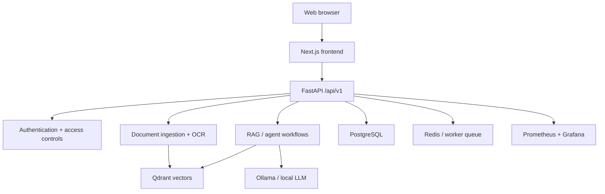

<div align="center">

# Offline Enterprise AI Copilot
### Private-first LLM and retrieval platform

**Local models · Hybrid RAG · Agents · FastAPI · Next.js · MLOps**


[Quick start](#quick-start) · [Architecture](#architecture) · [Security](#security-and-operational-notes) · [Source](https://github.com/FaizanAKhan786/offline-enterprise-copilot)

</div>

## Overview

An **offline-oriented enterprise AI copilot codebase** for teams that want control over models, documents and inference. It combines a Next.js interface with FastAPI services, RAG, local-model adapters and an operational stack. It is a repository implementation, **not** evidence of a security-certified or independently audited production deployment.

| Area | Implementation |
| --- | --- |
| Interface | Next.js, chat and document workflows |
| API | FastAPI with auth, document, chat, agent and model routes |
| RAG | Qdrant, embeddings and sparse/dense retrieval design |
| AI runtimes | Local Ollama / configurable model stack |
| Persistence | PostgreSQL and Redis |
| Telemetry | Prometheus, Grafana and application logging |
| Infrastructure | Docker Compose and Kubernetes manifests |

## Architecture



## Quick start

**Requirements:** Docker + Compose v2, sufficient storage for model weights, and GPU resources if using the bundled GPU profile.

```bash
git clone https://github.com/FaizanAKhan786/offline-enterprise-copilot.git
cd offline-enterprise-copilot
cp .env.example .env
# Edit .env: change default JWT/admin/database credentials
docker compose -f infra/docker/docker-compose.yml --profile gpu up -d --build
docker compose -f infra/docker/docker-compose.yml exec ollama ollama pull llama3:8b
```

After the services initialize, inspect [the frontend](http://localhost:3000), [FastAPI docs](http://localhost:8000/docs) and [the API health endpoint](http://localhost:8000/api/v1/health). Use:

```bash
docker compose -f infra/docker/docker-compose.yml ps
docker compose -f infra/docker/docker-compose.yml logs -f backend
```

**Configuration note:** the Compose file supplies a GPU reservation for the Ollama service; users without a suitable NVIDIA setup must adjust the model service configuration. The included setup script also needs environment-specific review before relying on it.

For source-first exploration, see [backend](backend/), [frontend](frontend/) and [infrastructure](infra/). The file [`.env.example`](.env.example) documents the major settings.

## Security and operational notes

- **Replace all example credentials**, especially `JWT_SECRET`, `DEFAULT_ADMIN_PASSWORD`, and database passwords.
- Restrict exposed service ports, set up HTTPS, secure storage and disable demo defaults before any real deployment.
- Offline behavior depends on the complete environment: downloaded weights, container images, telemetry endpoints and access policies.
- Descriptions of local processing are **architectural goals**, not a guarantee that every dependency or operating environment has been audited for network access.

## Development pointers

| Area | Path |
| --- | --- |
| FastAPI application | [`backend/app/main.py`](backend/app/main.py) |
| Dependency setup | [`backend/requirements.txt`](backend/requirements.txt) |
| Next.js frontend | [`frontend/`](frontend/) |
| Compose stack | [`infra/docker/docker-compose.yml`](infra/docker/docker-compose.yml) |
| Kubernetes manifests | [`infra/k8s/`](infra/k8s/) |
| Contributor notes | [`CONTRIBUTING.md`](CONTRIBUTING.md) |

The README presents the repository's current architecture and setup paths. It does not claim a successful clean-room deployment or benchmark run.

[Issues](https://github.com/FaizanAKhan786/offline-enterprise-copilot/issues) · [GitHub profile](https://github.com/FaizanAKhan786)
